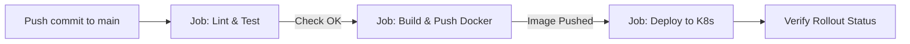

# Hướng dẫn thiết lập Gitea CI/CD cho dự án Django

Tài liệu này hướng dẫn cách cấu hình và tự động hóa quy trình CI/CD với **Gitea Actions** để build Docker image và deploy lên **Kubernetes Cluster**.

Workflow được lưu tại: [.gitea/workflows/deploy.yaml](file:///c:/Users/taipb.ETC/Documents/workspace/projects/sac/tool/.gitea/workflows/deploy.yaml)

---

## 1. Kiến trúc luồng CI/CD



1. **Lint & Test**:
   - Khởi tạo môi trường Python 3.13 với `uv`.
   - Cài đặt thư viện dependencies từ `uv.lock`.
   - Chạy lệnh `python manage.py check` để đảm bảo code Django hợp lệ.
2. **Build & Push**:
   - Sử dụng Docker Buildx để build image từ `Dockerfile`.
   - Đăng nhập vào Container Registry (Docker Hub / Harbor / Gitea Container Registry).
   - Đánh 2 tag: `${SHORT_SHA}` (commit hash rút gọn) và `latest`.
   - Push image lên Registry.
3. **Deploy to K8s**:
   - Cấu hình file `kubeconfig` trên runner.
   - Kiểm tra kết nối tới K8s cluster (`kubectl cluster-info`).
   - Cập nhật manifest và set image mới cho `deployment/django-app` trong namespace `sac-tool`.
   - Chờ và giám sát `rollout status` hoàn thành.

---

## 2. Chuẩn bị trên Gitea

### Bước 1: Kích hoạt Gitea Actions cho Repository
1. Vào repository trên giao diện web của Gitea.
2. Vào **Settings** (Cài đặt) -> **Repository** (Kho lưu trữ).
3. Tại mục **Enable Repository Actions**, tích chọn **Enable Actions** và bấm **Save**.
4. Lúc này tab **Actions** sẽ xuất hiện trên thanh menu của repo.

> **Lưu ý về Runner**: Gitea Actions yêu cầu có ít nhất 1 `act_runner` đang hoạt động và đăng ký với Gitea. Runner cần hỗ trợ nhãn `ubuntu-latest` (thường chạy qua Docker engine).

---

### Bước 2: Thiết lập Secret duy nhất trong Gitea (`KUBE_CONFIG`)
Vào **Settings** -> **Actions** -> **Secrets** và chỉ cần thêm **1 Secret duy nhất**:

| Tên Secret | Bắt buộc | Giá trị mô tả |
| :--- | :---: | :--- |
| `KUBE_CONFIG` | **Có** | Toàn bộ nội dung file kubeconfig của cụm K3s. |

> 💡 **Lưu ý**: Bạn **không cần** thêm các secret tài khoản Registry (`REGISTRY_USERNAME`, `REGISTRY_PASSWORD`) vì hệ thống sử dụng Registry nội bộ (`10.10.74.67:5000` - tương tự các dịch vụ `sac-api`, `sac-portal`, `sac-collector`).

#### Cách lấy nội dung `KUBE_CONFIG` từ server K3s:
1. Mở file cấu hình trên server K3s:
   ```bash
   sudo cat /etc/rancher/k3s/k3s.yaml
   ```
2. Thay `127.0.0.1` thành IP thật của node K3s server (VD: `https://10.10.74.67:6443` hoặc IP node master):
   ```yaml
   server: https://<K3S_NODE_IP>:6443
   ```
3. Copy toàn bộ nội dung và dán vào secret **`KUBE_CONFIG`** trên Gitea.

---

## 4. Kích hoạt và kiểm tra Pipeline

### Kích hoạt tự động
- Đẩy commit lên nhánh `main` hoặc `master`:
  ```bash
  git add .
  git commit -m "feat: add gitea actions pipeline"
  git push origin main
  ```

### Kích hoạt thủ công (Manual Run)
- Vào tab **Actions** trên Gitea repo.
- Chọn workflow **Build and Deploy to Kubernetes**.
- Nhấn nút **Run workflow**.

### Xem logs quá trình chạy
- Nhấp vào từng job (`lint-and-test`, `build-and-push`, `deploy-k8s`) để theo dõi logs chi tiết từng bước.

---

## 5. Đặc thù và hướng dẫn triển khai trên cụm K3s

K3s là Kubernetes siêu nhẹ (Rancher) có một số điểm khác biệt so với cụm K8s thông thường:

### 5.1. Thành phần của K3s
- **Ingress Controller**: Đang dùng **Nginx Ingress Controller**. File [ingress.yaml](file:///c:/Users/taipb.ETC/Documents/workspace/projects/sac/tool/k8s/ingress.yaml) đã được cấu hình với `ingressClassName: nginx` và các annotations chuẩn (`proxy-body-size: 50m`, timeout, v.v.).
- **StorageClass**: K3s dùng sẵn `local-path` (`rancher.io/local-path`). File [pvc.yaml](file:///c:/Users/taipb.ETC/Documents/workspace/projects/sac/tool/k8s/pvc.yaml) sẽ tự động liên kết với ổ cứng node mà không cần cài thêm CSI plugin.

---

### 5.2. Cách 1: Chạy Act Runner TRỰC TIẾP trong cụm K3s (Khuyên dùng)
Bạn có thể deploy Gitea Runner thành Pod chạy ngay bên trong K3s. Lúc này Runner tự kết nối tới K8s qua **ServiceAccount**, bạn **không cần tạo Secret `KUBECONFIG`** trên Gitea!

Dự án đã chuẩn bị sẵn manifest: [gitea-act-runner.yaml](file:///c:/Users/taipb.ETC/Documents/workspace/projects/sac/tool/k8s/gitea-act-runner.yaml).

1. Lấy Token đăng ký Runner từ Gitea:
   - Truy cập Gitea: Repo (hoặc Org/Site Admin) -> **Settings** -> **Actions** -> **Runners** -> bấm **Create new Runner** để copy registration token.
2. Mở file [gitea-act-runner.yaml](file:///c:/Users/taipb.ETC/Documents/workspace/projects/sac/tool/k8s/gitea-act-runner.yaml) và điền:
   - `GITEA_INSTANCE_URL`: Địa chỉ web Gitea của bạn.
   - `GITEA_RUNNER_REGISTRATION_TOKEN`: Token vừa copy ở trên.
3. Deploy runner lên K3s:
   ```bash
   kubectl apply -f k8s/gitea-act-runner.yaml
   ```
4. Kiểm tra pod runner:
   ```bash
   kubectl get pods -n gitea-runner
   ```
   *Khi pod ở trạng thái `Running`, runner sẽ tự động online trên giao diện Gitea!*

---

### 5.3. Cách 2: Runner ở ngoài kết nối vào K3s qua `KUBECONFIG`
Nếu Runner chạy ngoài cụm K3s (VD: trên máy riêng hoặc server Gitea):
1. Lấy file kubeconfig trên node master K3s:
   ```bash
   sudo cat /etc/rancher/k3s/k3s.yaml
   ```
2. **QUAN TRỌNG**: Mặc định file `k3s.yaml` chứa:
   ```yaml
   server: https://127.0.0.1:6443
   ```
   Bạn **phải sửa `127.0.0.1`** thành IP hoặc Domain thật của node K3s server:
   ```yaml
   server: https://<K3S_NODE_IP>:6443
   ```
3. Copy toàn bộ nội dung đã sửa và dán vào secret **`KUBECONFIG`** trên Gitea.
4. *(Nếu gặp lỗi TLS certificate do IP ngoài không khớp SANs của K3s)*:
   - Thêm cờ `--tls-san <IP_NGOAI>` vào file cấu hình `/etc/rancher/k3s/config.yaml` rồi restart K3s:
     ```bash
     sudo systemctl restart k3s
     ```

---

## 6. Xử lý các lỗi thường gặp (Troubleshooting)

1. **Lỗi `runner cannot connect to Docker daemon`**:
   - Nếu chạy runner ngoài: Runner cần quyền truy cập `/var/run/docker.sock`.
   - Nếu chạy runner trong K3s: Sử dụng manifest [gitea-act-runner.yaml](file:///c:/Users/taipb.ETC/Documents/workspace/projects/sac/tool/k8s/gitea-act-runner.yaml) đã có sẵn sidecar `docker:dind` (chạy chế độ `privileged: true`).

2. **Lỗi `The connection to the server 127.0.0.1:6443 was refused`**:
   - Quên chưa đổi `127.0.0.1` trong file `/etc/rancher/k3s/k3s.yaml` thành IP node K3s thật.

3. **Lỗi `ImagePullBackOff` trên K3s Pod**:
   - Private registry chưa được xác thực trên cluster. Tạo secret:
     ```bash
     kubectl create secret docker-registry regcred \
       --docker-server=<REGISTRY> \
       --docker-username=<USER> \
       --docker-password=<PASS> \
       -n sac-tool
     ```
     Sau đó thêm `imagePullSecrets: [{name: regcred}]` vào [deployment.yaml](file:///c:/Users/taipb.ETC/Documents/workspace/projects/sac/tool/k8s/deployment.yaml).
