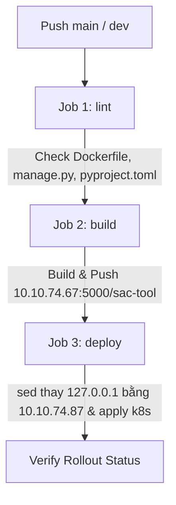

# Hướng dẫn Gitea CI/CD chuẩn cho cụm K3s (Theo mẫu dự án nội bộ)

Tài liệu này giải thích chi tiết cấu hình CI/CD trong [.gitea/workflows/deploy.yaml](file:///c:/Users/taipb.ETC/Documents/workspace/projects/sac/tool/.gitea/workflows/deploy.yaml) được chuẩn hóa đồng bộ theo mẫu chuẩn dự án đang chạy thành công của bạn.

---

## 1. Điểm cốt lõi giải quyết lỗi phân giải tên miền (DNS)

Trong container runner `ubuntu-latest`, DNS mặc định không phân giải được domain nội bộ `git.sgn.local` hoặc `gitea-server`. Giải pháp chuẩn từ mẫu của bạn:

```bash
# 1. Map trực tiếp IP Gitea vào file /etc/hosts trong container runner
echo "10.10.74.67 git.sgn.local" | sudo tee -a /etc/hosts || echo "10.10.74.67 git.sgn.local" >> /etc/hosts

# 2. Tắt SSL verify và dùng token nội bộ clone code an toàn
git config --global http.sslVerify false
export GIT_TERMINAL_PROMPT=0
git clone https://x-access-token:${{ secrets.GITHUB_TOKEN }}@git.sgn.local/${{ gitea.repository }}.git .
git checkout ${{ gitea.sha }}
```

---

## 2. Thông số hạ tầng nội bộ

- **Gitea Server**: `10.10.74.67` (`git.sgn.local`)
- **Docker Registry**: `10.10.74.67:5000`
- **K3s Server Master**: `10.10.74.87` (Được tự động thay thế vào `kubeconfig.yaml` qua lệnh `sed`)
- **Namespace K8s**: `sac-tool`
- **Secret duy nhất trên Gitea**: `KUBE_CONFIG`

---

## 3. Các giai đoạn trong Pipeline (`deploy.yaml`)



1. **Job `lint`**: Kiểm tra sự tồn tại của các file cốt lõi: `Dockerfile`, `pyproject.toml`, `manage.py`, `config/`.
2. **Job `build`**:
   - Tự động gán tag: `prod-${SHA}` và `prod-latest` (nếu push nhánh `main`), hoặc `dev-${SHA}` và `dev-latest` (nếu nhánh khác).
   - Build và push thẳng lên `10.10.74.67:5000/sac-tool`.
3. **Job `deploy`**:
   - Ghi secret `KUBE_CONFIG` ra file `kubeconfig.yaml`.
   - Tự động thay thế `localhost`/`127.0.0.1` thành IP master K3s `10.10.74.87`.
   - Tạo namespace `sac-tool` nếu chưa có.
   - Thay thế tag image trong [deployment.yaml](file:///c:/Users/taipb.ETC/Documents/workspace/projects/sac/tool/k8s/deployment.yaml) và chạy `kubectl apply`.
   - Theo dõi trạng thái rollout: `kubectl rollout status deployment/django-app -n sac-tool`.

---

## 4. Thiết lập trên Gitea

Chỉ cần vào **Settings** -> **Actions** -> **Secrets** của repo và thêm **1 Secret duy nhất**:

| Tên Secret | Bắt buộc | Mô tả |
| :--- | :---: | :--- |
| `KUBE_CONFIG` | **Có** | Toàn bộ nội dung file `/etc/rancher/k3s/k3s.yaml` (pipeline sẽ tự động xử lý IP `10.10.74.87`). |
